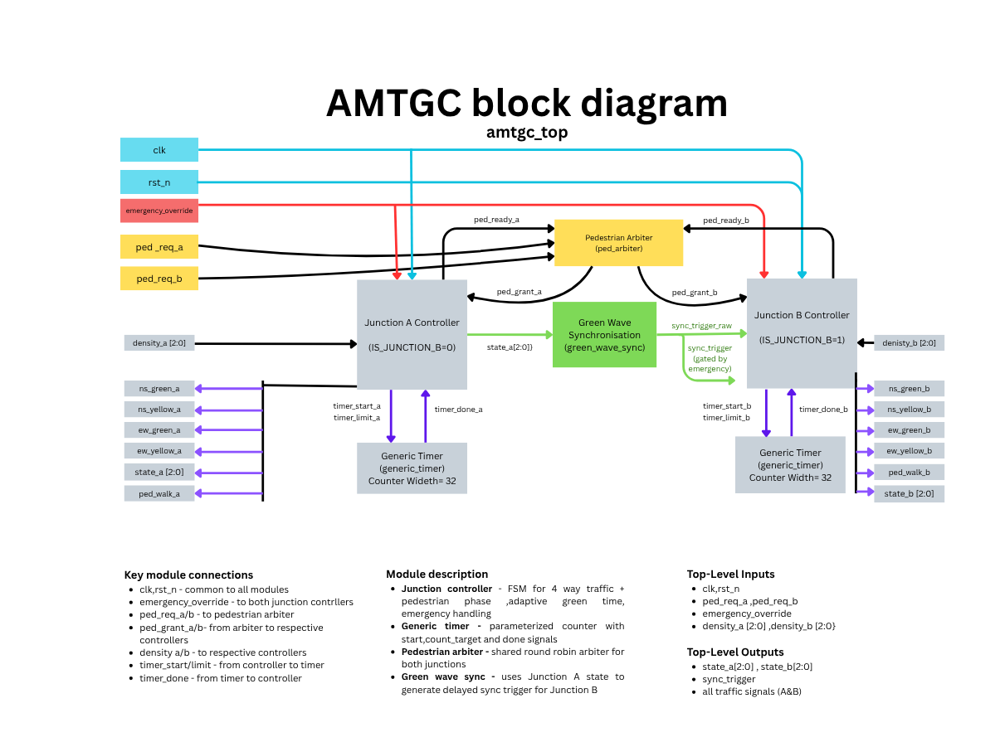

# Adaptive Multi-Junction Traffic Grid Controller (AMTGC)
## Technical Report & Architectural Specification

**Author:** Aathira Vijay  
**Repository:** [adaptive-traffic-controller](https://github.com/aathiravijaypnr-lab/adaptive-traffic-controller)  
**Date:** October 25, 2026  
**Document Version:** 1

---

## Executive Abstract

This report presents the architecture, Verilog RTL implementation, and ModelSim verification of the Adaptive Multi-Junction Traffic Grid Controller (AMTGC). The system coordinates two four-way traffic intersections, Junction A and Junction B, using reusable hardware modules.

The design supports traffic-density-based adaptive green timing, green-wave synchronization, centralized round-robin pedestrian arbitration, and a system-wide emergency override. Independent parameterized timers control the traffic phases of both junctions.

The integrated design was verified using a self-checking ModelSim testbench. The reported simulation completed **39 PASS checks, 0 FAIL checks**, and a **1,000-cycle randomized stress test with no reported invariant violations**.

---

## 1. Project Overview and System Specifications

### 1.1 Introduction

Modern traffic management systems require coordinated signal control to manage changing traffic density, pedestrian requests, and emergency conditions.

The AMTGC project implements a two-junction traffic control system entirely in Verilog RTL. Both junctions use the same reusable controller module, with separate timing resources and shared coordination logic.

### 1.2 Functional Features

- **Dual-Junction Control:** Independent North–South (NS) and East–West (EW) traffic phases at Junction A and Junction B.
- **Adaptive Green Timing:** Green duration adjusts according to a three-bit traffic density input.
- **Green-Wave Synchronization:** Junction B receives a delayed synchronization trigger derived from Junction A's NS-green phase.
- **Shared Pedestrian Arbitration:** A centralized round-robin arbiter manages requests from both junctions.
- **Emergency Override:** A common emergency signal suppresses traffic and pedestrian indications and forces both controllers into emergency handling.
- **Parameterized Timing:** Configurable timing parameters support reuse without changing the FSM logic.
- **Modular RTL Architecture:** Controllers, timers, pedestrian arbitration, and synchronization are implemented in separate modules.

### 1.3 Clock and Reset

All modules operate in a single clock domain using `clk`.

The active-low reset input is `rst_n`. The junction controllers, generic timers, and green-wave synchronizer use asynchronous active-low reset. The pedestrian arbiter samples reset synchronously on the rising clock edge.

---

## 2. System Architecture and RTL Design

### 2.1 Top-Level Architecture

The top-level module `amtgc_top.v` integrates the following modules:

| RTL Module | Instances | Purpose |
| :--- | :---: | :--- |
| `junction_controller.v` | 2 | Controls traffic phases at Junction A and Junction B |
| `generic_timer.v` | 2 | Provides independent phase timing |
| `ped_arbiter.v` | 1 | Coordinates pedestrian requests |
| `green_wave_sync.v` | 1 | Generates the delayed synchronization trigger |

**Architecture block diagram:**

*Figure 1: Top-level AMTGC architecture showing the two junction controllers, independent timers, shared pedestrian arbiter, and green-wave synchronization module.*

The architecture follows these principal signal paths:

1. Each junction controller communicates with its own generic timer using `timer_start`, `timer_limit`, and `timer_expired`.
2. Junction A's FSM state is monitored by `green_wave_sync`.
3. The synchronization module produces a delayed trigger for Junction B.
4. The shared pedestrian arbiter receives requests and readiness signals and generates grants for the junction controllers.
5. The global emergency input reaches both controllers and masks pedestrian requests and the synchronization output.

### 2.2 Top-Level Interface Specification

| Signal | Direction | Width | Description |
| :--- | :--- | :---: | :--- |
| `clk` | Input | 1 | Common system clock |
| `rst_n` | Input | 1 | Active-low reset |
| `ped_req_a` | Input | 1 | Junction A pedestrian request |
| `ped_req_b` | Input | 1 | Junction B pedestrian request |
| `emergency_override` | Input | 1 | Global emergency control |
| `density_a` | Input | 3 | Junction A traffic density |
| `density_b` | Input | 3 | Junction B traffic density |
| `state_a` | Output | 3 | Junction A FSM state |
| `state_b` | Output | 3 | Junction B FSM state |
| `ns_green_a` | Output | 1 | Junction A NS green |
| `ns_yellow_a` | Output | 1 | Junction A NS yellow |
| `ew_green_a` | Output | 1 | Junction A EW green |
| `ew_yellow_a` | Output | 1 | Junction A EW yellow |
| `ped_walk_a` | Output | 1 | Junction A pedestrian walk |
| `ns_green_b` | Output | 1 | Junction B NS green |
| `ns_yellow_b` | Output | 1 | Junction B NS yellow |
| `ew_green_b` | Output | 1 | Junction B EW green |
| `ew_yellow_b` | Output | 1 | Junction B EW yellow |
| `ped_walk_b` | Output | 1 | Junction B pedestrian walk |
| `sync_trigger` | Output | 1 | Observable synchronization pulse |

The design does not expose separate red-light output pins. An all-red interval is represented by all vehicle green/yellow and pedestrian walk outputs being inactive.

### 2.3 RTL Module Descriptions

#### 2.3.1 Generic Timer

The `generic_timer.v` module implements a reusable parameterized counter.

Its main interface includes:

| Signal | Direction | Purpose |
| :--- | :--- | :--- |
| `clk` | Input | Clock |
| `rst_n` | Input | Active-low reset |
| `start` | Input | Enables counting |
| `count_target` | Input | Required count duration |
| `done` | Output | Completion pulse |

The timer supports configurable counter widths, target changes, stop/restart operation, and zero-target handling.

#### 2.3.2 Junction Controller

The `junction_controller.v` module implements an eight-state traffic control FSM.

Each controller determines traffic phase transitions, adaptive green durations, pedestrian phases, emergency behavior, and the timer count target.

Both Junction A and Junction B are instantiated from the same RTL module. The `IS_JUNCTION_B` parameter enables the additional synchronization behavior required at Junction B.

#### 2.3.3 Pedestrian Arbiter

The `ped_arbiter.v` module receives pedestrian requests and junction readiness signals.

It uses a round-robin `turn` register to alternate priority when both junctions are eligible, preventing simultaneous grants.

#### 2.3.4 Green-Wave Synchronizer

The `green_wave_sync.v` module detects Junction A entering the NS-green state.

After a configurable delay, it generates a one-cycle synchronization pulse for Junction B.

---

## 3. Finite State Machine Design

Each junction controller implements eight encoded states.

### 3.1 FSM State Table

| State | Encoding | Function |
| :--- | :---: | :--- |
| `ST_RESET` | `3'b000` | Reset state with inactive traffic outputs |
| `ST_NS_GREEN` | `3'b001` | North–South green phase |
| `ST_NS_YELLOW` | `3'b010` | North–South yellow phase |
| `ST_EW_GREEN` | `3'b011` | East–West green phase |
| `ST_EW_YELLOW` | `3'b100` | East–West yellow phase |
| `ST_PED_WALK` | `3'b101` | Pedestrian crossing phase |
| `ST_ALL_RED` | `3'b110` | All-red safety interval |
| `ST_EMERGENCY` | `3'b111` | Emergency override state |

### 3.2 Normal State Transitions

The normal phase sequence is:

`ST_RESET` → `ST_ALL_RED` → `ST_NS_GREEN` → `ST_NS_YELLOW` → `ST_ALL_RED`

After the NS-yellow clearance interval, the controller selects the appropriate next phase according to its internal flags and pedestrian request status.

The normal EW sequence is:

`ST_EW_GREEN` → `ST_EW_YELLOW` → `ST_ALL_RED` → `ST_NS_GREEN`

A pedestrian walk phase may be inserted after a safe all-red interval when an eligible pedestrian request has been accepted.

Junction B additionally waits for the synchronization condition before entering NS green when required.

### 3.3 All-Red Safety State

The design uses one reusable `ST_ALL_RED` state rather than separate all-red states for NS-to-EW and EW-to-NS transitions.

Internal control flags determine the next phase. The all-red timer must complete before the controller exits this state.

### 3.4 Emergency State

When `emergency_override` is asserted:

- Green, yellow, and pedestrian walk outputs are suppressed immediately through combinational gating.
- Both junction controllers enter `ST_EMERGENCY` on the next rising clock edge.
- The synchronization output is masked.
- After emergency release, the controllers return through `ST_ALL_RED` before resuming traffic operation.

The FSM uses state-based phase decoding with an additional emergency output mask.

---

## 4. Adaptive Timing and Synchronization

### 4.1 Timing Parameters

| Parameter | Default Value | Purpose |
| :--- | ---: | :--- |
| `MIN_GREEN_TIME` | 5 | Minimum green duration |
| `MAX_GREEN_TIME` | 10 | Maximum green duration |
| `GREEN_EXTENSION` | 1 | Green extension per density level |
| `YELLOW_TIME` | 3 | Yellow duration |
| `RED_TIME` | 8 | All-red duration |
| `PEDESTRIAN_TIME` | 6 | Pedestrian walk duration |
| `SYNC_OFFSET_TIME` | 4 | Synchronization delay |

Both junction controllers use the same default timing parameters. Their adaptive green durations can differ because their traffic density inputs are independent.

### 4.2 Adaptive Green-Time Calculation

The controller computes the green count target using:

`Calculated Green Time = MIN_GREEN_TIME + (traffic_density × GREEN_EXTENSION)`

The result is limited to the configured minimum and maximum values.

With the default parameters:

| Traffic Density | Green Count Target |
| ---: | ---: |
| 0 | 5 |
| 1 | 6 |
| 2 | 7 |
| 3 | 8 |
| 4 | 9 |
| 5 | 10 |
| 6 | 10 |
| 7 | 10 |

The green count target is sampled when entering the green phase. Changes in traffic density during an active green phase do not modify the stored target.

### 4.3 Green-Wave Synchronization

The green-wave synchronization module monitors Junction A's FSM state.

When Junction A enters `ST_NS_GREEN`, the synchronizer starts its configured delay and generates a pulse for Junction B.

Junction B uses the synchronization pulse, or a retained pending synchronization event, when its all-red interval has completed and it is ready to enter NS green.

The integrated testbench reported the expected four-cycle offset in five tested synchronization scenarios.

### 4.4 Shared Pedestrian Arbitration

The shared pedestrian arbiter receives requests from both junctions.

Readiness signals are derived from the junction states, and arbitration occurs when the corresponding requests and readiness conditions are satisfied.

The arbiter uses a `turn` register to alternate priority when both junctions are eligible.

The top-level fairness test recorded:

| Measurement | Result |
| :--- | ---: |
| Arbitration cycles | 100 |
| Junction A grants | 50 |
| Junction B grants | 50 |
| Alternation errors | 0 |

These results demonstrate the observed fairness behavior in the tested scenario.

---

## 5. Verification Methodology

### 5.1 Simulation Environment

The integrated AMTGC system was verified using ModelSim and the self-checking top-level testbench:

`tb/amtgc_top_tb.v`

The verification strategy combined directed functional testing and randomized stimulus.

### 5.2 Test Scenarios

The testbench covered:

1. Reset and recovery behavior.
2. Emergency override during different traffic phases.
3. Rapid emergency assertion and release.
4. Pedestrian arbitration fairness.
5. Adaptive green-time calculation.
6. Green-wave synchronization.
7. Randomized traffic and pedestrian conditions.

### 5.3 Simulation Results

| Test Scenario | PASS | FAIL |
| :--- | ---: | ---: |
| Reset and Recovery | 6 | 0 |
| Emergency Preemption | 10 | 0 |
| Rapid Emergency Toggle | 1 | 0 |
| Pedestrian Fairness | 3 | 0 |
| Adaptive Timing and Green-Wave | 18 | 0 |
| Constrained-Random Stress | 1 | 0 |
| **Total** | **39** | **0** |

**Final Integrated Verification Result: 39 PASS / 0 FAIL**

The randomized test executed 1,000 simulation cycles and reported no invariant violations.

### 5.4 Simulation Waveform Evidence

The repository contains the following simulation evidence:

| File | Purpose |
| :--- | :--- |
| `sim/simulation_run.log` | Integrated ModelSim simulation transcript |
| `sim/waveform_normal_operation.png` | Normal traffic signal operation |
| `sim/waveform_emergency_override.png` | Emergency override behavior |
| `sim/waveform_ped_arbiter.png` | Pedestrian arbitration behavior |
| `sim/waveform_adaptive_timing.png` | Adaptive timing behaviour |

---

## 6. Challenges Faced and Debugging

### 6.1 Timer Edge Cases

The timer design required careful handling of zero-count targets, timer restart behavior, target changes, and one-cycle completion pulses.

The final implementation uses counter and target-tracking logic to handle these conditions.

### 6.2 Pedestrian Arbitration Fairness

A centralized arbiter was used to avoid independent pedestrian controllers making conflicting grant decisions.

Round-robin selection provides alternating priority when both junctions are eligible.

### 6.3 Adaptive Timing Stability

Changing traffic density during an active green phase could otherwise alter the timer target.

The controller therefore stores the calculated green duration when entering a green phase.

### 6.4 Synchronization and Emergency Coordination

The synchronization logic must coordinate Junction B without bypassing its all-red safety interval.

The top-level design also masks synchronization and pedestrian request signals during emergency operation.

### 6.5 Verification Timing

The verification process required careful alignment of testbench checks with clock edges, registered outputs, and timer completion pulses.

The integrated testbench ultimately reported 39 successful checks with no failures.

Additional debugging details are maintained separately in `docs/bug_log.md`.

---

## 7. Conclusion

The Adaptive Multi-Junction Traffic Grid Controller demonstrates a modular Verilog RTL implementation of coordinated traffic control across two intersections.

The design integrates:

- Two reusable traffic junction controllers.
- Two independent parameterized timers.
- Adaptive green timing based on traffic density.
- A shared round-robin pedestrian arbiter.
- Green-wave synchronization.
- System-wide emergency override handling.

The integrated ModelSim verification reported **39 PASS checks, 0 FAIL checks**, and no reported invariant violations during the 1,000-cycle randomized test.

The project includes RTL source files, verification evidence, architectural documentation, and supporting submission materials.

---

## 8. Project Deliverables

| Deliverable | Repository Location |
| :--- | :--- |
| RTL source files | `rtl/` |
| Integrated testbench | `tb/amtgc_top_tb.v` |
| Simulation log | `sim/simulation_run.log` |
| Waveform screenshots | `sim/` |
| Top-level block diagram | `docs/amtgc_top_block_diagram.png` |
| Junction controller diagram | `docs/junction_controller_diagram.png` |
| Technical report | `docs/technical_report.md` |
| Bug log | `docs/bug_log.md` |
| Design assumptions | `docs/assumptions.md` |
| Self-attestation checklist | `docs/self_attestation_checklist.md` |
| Project overview | `README.md` |

**End of Technical Report**
